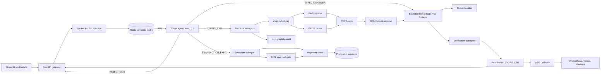

# design.md: The Unreliable Assistant, Enterprise Blueprint

Written for: the hackathon team (engineers and reviewers) and Claude Code sessions. This is the Gate 1 artifact. It must be reviewed and locked before application code is written.

## Status: LOCKED (2026-11-18)

The product owner approved the defaults below and asked the team to choose the best design for the brief. Choices marked D-numbers are locked. Changing one requires a new entry here first.

| # | Locked decision | Why / deviation from brief |
|---|---|---|
| D1 | Gate 1 file is `design.md` (lowercase). | Brief names it that way. |
| D2 | Subagent is called **Verification Subagent**. Its audit-log duty is part of it. | Gate 6/7 table uses this name. Gate 2 says "Audit", so the diagram label now reads "Verification Subagent (audit log, RAGAS triad)". |
| D3 | Routes: `DIRECT_ANSWER`, `HYBRID_RAG`, `TRANSACTION_EXEC`, `REJECT_OOS`. | `REJECT_OOS` is in §3 but not in the brief's Gate 2 list. Kept. |
| D4 | State store is **SQLite** (WAL mode), with `tenant_id` on every table and every query. Postgres/pgvector is the production target. It is **not implemented** in this build. | Deviation from Gate 0. Docker is not available here, so Postgres and Redis are not running. See A8. |
| D5 | Cache is an **in-process** TTL cache keyed `SHA256(tenant_id:user_id:norm_query)`, with a jittered TTL of 300 s ± 45 s, and a semantic match restricted to the same tenant and user. Redis is **not implemented** in this build. | Same as §6 `CacheEntry`. Redis is the production target. |
| D6 | Dense embedder is **BAAI/bge-large-en-v1.5** through fastembed (ONNX, no torch). Index is **FAISS HNSW** (efSearch 64). | Brief lists both IVF-PQ and HNSW. HNSW is used because it meets the 25 ms budget on a 4-CPU machine. |
| D7 | Reranker is **BAAI/bge-reranker-v2-m3 INT8** (`bge-reranker-v2-m3-int8`) through fastembed. | FP16 is not in the fastembed build list. INT8 is the R4 fallback, used on CPU. |
| D8 | LLM provider: see D25 (OpenRouter). Earlier text, superseded: the Anthropic API when `ANTHROPIC_API_KEY` is set. Triage is rules-first (local, under 25 ms). The LLM is only used for low-confidence triage and for generation. With no key, generation uses the extractive fallback from §8. | No API key in this environment. Fallback behavior is the tested path. |
| D9 | Triage budget (≤ 25 ms) is reported for the rules path. The LLM path is reported separately and is not claimed to meet the budget. | Resolves A9 and R3. |
| D10 | End-to-end latency budget is 450 ms p95 (A9 default). | Brief is ambiguous. |
| D11 | Load test is **scaled**: k6 script with brief thresholds, run at the highest VU count that holds, reported as "scaled run, N VUs". The 50K run is not claimed. | Resolves A11 and R2. |
| D12 | RAGAS runs only when an LLM judge key is set. Without one, the scorecard shows NOT_MEASURED for the RAGAS metrics. Offline proxies are labelled "proxy", never as RAGAS. | Honest reporting. |
| D13 | Golden set: 50 synthetic questions generated from the vault, stratified 25/25/20/15/15. Red team: 100 prompts across the five brief categories, generated from templates. Both are labelled synthetic. | Resolves A7. |
| D14 | Pluggy is not used. Plugins are an ordered list of pre- and post-hooks with `priority` and `fail_closed`. | Cut item C5. |
| D15 | HITL approval records are stored in SQLite. Approving runs a local stub action and writes an audit event. No external system is changed. | Demo only. |
| D16 | Tenant comes from the `X-Tenant-ID` header and must match the body `tenant_id`. Mismatch returns `E_RBAC_DENIED`. | Enforces tenant isolation at the edge. |
| D17 | Corpus is a synthetic vault in `knowledge_vault/`, built by us. | Resolves A4 for the demo. Real corpus replaces it when provided. |
| D18 | MCP resource is `rag://tenants/{tenant_id}/chunks/{chunk_id}`, not `rag://chunks/{id}`. A chunk is returned only if the tenant is entitled to it. Missing and forbidden give the same `E_NOT_FOUND`. | Deviation from §7. A resource without a tenant would leak chunks across tenants. |
| D19 | The vault link graph is built from `[[wikilinks]]` by `app/graph.py`. It is not built by the Graphify CLI. | Graphify availability is unconfirmed (CLAUDE.md §3). The MCP tool contract is unchanged. |
| D20 | Iteration limit (5) is **hard**. Time budgets (120 ms per step, 450 ms total) are **soft** by default and are reported as breaches. Set `ENFORCE_TIME_BUDGETS=1` to enforce them on target hardware. | On this 4-vCPU host, the reranker alone takes about 7 s, so enforcing the budgets would make every answer fail. Breaches are recorded, not hidden. |
| D21 | All three MCP servers use **stdio** transport. The state store is not on Streamable HTTP. | Deviation from Gate 0. All servers run on one host as child processes. Switching transport later is a config change. |
| D22 | The Verification Subagent uses a **lexical** claim check: each cited sentence must share at least 50% of its content words with its cited chunk. It is not NLI. KPI-24 is therefore reported as NOT_MEASURED, with the lexical rate as a proxy only. | No NLI model is named in the brief, and no judge LLM is available. |
| D23 | Load tests use **k6** (v2.3.0) with the brief's thresholds, scaled by `PEAK_VUS`. Tenants are `tenant_a` and `tenant_b`, the vault's real tenants. The brief's `tenant_0..tenant_49` do not exist here. | Deviation from brief. Results are reported with the VU count. The 50K run is not claimed. |
| D24 | Dependency pins: `mcp>=1.2,<2` (the v2 API was renamed; this build uses FastMCP from v1), `nltk` (Porter stemmer, as specified in Gate 3). | Found during the build. |
| D25 | LLM provider is **OpenRouter** (OpenAI-compatible HTTP, `https://openrouter.ai/api/v1`), models set by `OPENROUTER_MODEL` (default `anthropic/claude-sonnet-5.5`, see D29; earlier choice `x-ai/grok-4.3` was blocked). Anthropic is an optional alternative used only when no OpenRouter key is set. With no key, everything runs on the rules and the extractive answerer. | The user chose OpenRouter. Model IDs were checked against the public model list. Prices are in `.env.example` and feed KPI-29. |
| D26 | The LLM may route only to `DIRECT_ANSWER`, `HYBRID_RAG`, or `REJECT_OOS`, and only on low-confidence rules results. It can never create a `TRANSACTION_EXEC` request. Tier 3 requests are rules-only. | Safety: a model must not be able to start a Tier 3 change. Enforced in `parse_llm_triage` and tested. |
| D27 | Gate 2 files `docs/workflow.dot` and `docs/workflow_orchestration.png` stay in `docs/` (the brief's path) and are re-included in `.gitignore` with `docs/*` plus negations, so they are tracked. | `docs/` as a whole pattern would exclude them from git. |
| D28 | The `.env` loader is built in (`app/config.py`). Real environment variables take precedence over `.env`. `.env` is git-ignored. | Avoids a new dependency. |
| D29 | Models on OpenRouter: generation `anthropic/claude-sonnet-5.5`, triage `anthropic/claude-haiku-5.5`. Both were verified to answer on this account. Grok models and `anthropic/claude-opus-5.5` are blocked by the account's guardrails (HTTP 404, "matching your guardrail restrictions and data policy"). Per-model prices are in `app/config.py`. | Grok was the first choice, but guardrails blocked it. Changing the guardrail settings is the account owner's decision, so the design uses the allowed Claude models. |

## Measured on this host (2026-11-18, 4 vCPU, 15 GB RAM, CPU only)

Warm, single query. Models loaded once.

| Stage | Measured | Budget (brief) | Result |
|---|---|---|---|
| Query embedding + dense search (BGE-large, FAISS HNSW) | about 160 to 200 ms | <= 25 ms | Over budget. A hosted or GPU embedder is needed to meet it. |
| Cross-encoder rerank, 11 candidates (bge-reranker-v2-m3 INT8) | about 7 to 9 s | <= 45 ms | Over budget by two orders of magnitude on CPU. |
| `bge-reranker-base` (for comparison only) | about 1.7 s for 11 pairs | n/a | Also over budget, so the host is the limit, not the model choice. |
| BM25 | about 1 ms | <= 12 ms | Within budget. |

Exact numbers come from `data/results/kpis.json` after `scripts/scorecard.py` runs.

## Assumptions and Open Items (read first)

| # | Item | Status |
|---|---|---|
| A1 | Hackathon deadline, total hours, and checkpoint dates are not in the brief. Build plan (§11) uses a 48-hour working budget. | [ASSUMPTION] |
| A2 | Team size and owners are unknown. Owners are roles, not names. | [ASSUMPTION] |
| A3 | Judging criteria and weights are not in the brief. Proxy weights are in CLAUDE.md §8. | [ASSUMPTION] |
| A4 | The knowledge corpus is not provided. Demo uses a synthetic vault (D17). | [TO CONFIRM] |
| A5 | LLM provider is not named. Anthropic API is used when a key is set (D8). | [TO CONFIRM] |
| A6 | Resolved by D1. | Locked |
| A7 | The brief asks for a 250-question golden set and a 100-prompt red-team suite. Neither is provided. Team must author them. | [ASSUMPTION] 50-question MVP set, full set as stretch |
| A8 | The brief says both SQLite and Postgres. Design uses Postgres + pgvector, with SQLite as plan B. | [ASSUMPTION] |
| A9 | The brief's triage budget (≤ 25 ms) and generation TTFT (≤ 180 ms) are hard to meet with a hosted LLM API call. See §10, R3. | [TO CONFIRM] |
| A10 | The "Post-Hardening Audit Report" in the folder claims all 36 KPIs passed, but gives no per-KPI evidence. This design treats its numbers as claims, not as baselines. | [ASSUMPTION] |
| A11 | The brief's 50K-VU load test needs infrastructure the team probably lacks. Scaled plan in §12. | [TO CONFIRM] |
| A12 | No end-user chat UI is specified. The Streamlit workbench (Tab 1 query console) is the demo entry point. | [ASSUMPTION] |
| A13 | A pitch deck and demo video are not listed as deliverables. | [TO CONFIRM] |

---

## 1. Problem & Goals

**Problem.** The prototype gives answers that are not grounded in policy, leaks data across tenants, loops on tool errors, sends too many tokens, passes PII and injected instructions through, and has no approval step for risky actions.

**Target users**

| User | Need | Primary surface |
|---|---|---|
| Operations staff (asker) | Accurate, cited answers to policy and SOP questions | Query API, Tab 1 console |
| Compliance reviewer (approver) | Approve or reject Tier 3 actions with an audit trail | HITL queue (Tab 1), `/api/v1/hitl` |
| Engineer / judge (evaluator) | See whether the system meets the targets, with evidence | Tabs 2, 3, 5, 6 |

**Out of scope for users:** clinical, financial, or legal decisions without HITL.

**Success metrics (demo scope)**

| Metric | Target | Source |
|---|---|---|
| Faithfulness (RAGAS) | ≥ 0.92 | Golden set run |
| Answer relevancy | ≥ 0.90 | Golden set run |
| Context precision / recall | ≥ 0.88 / ≥ 0.85 | Golden set run |
| Abstention accuracy on unanswerable | ≥ 98% | Negative subset |
| PII redaction recall | ≥ 99.8% | Red team, PII cases |
| Injection block rate | ≥ 99.5% | Red team |
| Cross-tenant cache leaks | 0 | Concurrency probe |
| Infinite-loop escape | 100% | Chaos loop test |
| HITL enforcement on Tier 3 | 100% | Audit log check |
| End-to-end p95 latency | ≤ 450 ms | Load test (scaled, §9) |
| Prompt token reduction | ≥ 45% vs raw-chunk baseline | Token counter hook |

---

## 2. Solution Overview

The assistant takes a question from a user in a given tenant. It first removes personal data and screens for injected instructions. It checks a tenant-scoped cache. A triage step decides what kind of request it is. Factual questions go to a retrieval pipeline that searches the policy vault in three stages and reranks the best chunks. The model answers only from those chunks and cites them. If the evidence is weak, the assistant says it does not know. Requests that change state (for example, submitting a lot-status update) are not executed directly. They wait in an approval queue until a reviewer approves them. Every step is traced and logged.

---

## 3. User Flow

1. **Submit.** User sends a query with `tenant_id`, `user_id`, and optional `session_id` (Tab 1 form or `POST /api/v1/agent/query`).
2. **Pre-checks.** PII redactor, then injection shield. If the injection shield blocks, return `BLOCKED` with a fixed message and log the event. Redaction is applied before any further step, and the raw text is not stored.
3. **Cache.** Look up the tenant-scoped semantic cache (cosine ≥ 0.92). On a hit, return the cached answer with `cache_hit: true`.
4. **Triage.** Classify into intent, domain, risk tier, and complexity. Route to one of four paths:
   - `DIRECT_ANSWER`: general or conversational. No retrieval.
   - `HYBRID_RAG`: policy or SOP question. Go to step 5.
   - `TRANSACTION_EXEC`: state-changing request. Go to step 7.
   - `REJECT_OOS`: out of scope. Polite refusal.
5. **Retrieve.** Retrieval subagent runs BM25 and dense search in parallel, fuses with RRF, and reranks with the cross-encoder. If the top rerank score is below 0.42, return `ABSTAINED` with no LLM call.
6. **Generate and verify.** Generate an answer from the top 4 chunks, with citations. The verification subagent checks each claim against the chunks. Any ungrounded claim vetoes the draft. The result is `ANSWERED`, or `ABSTAINED` if the draft cannot be grounded.
7. **Transaction path.** Execution subagent validates arguments through the tool harness (strict validation, then auto-repair, then RBAC check, then idempotency key). It writes a `PENDING_APPROVAL` record and tells the user the request is pending. Nothing is executed yet.
8. **Approval.** A reviewer approves or rejects in Tab 1 or via the API. On approval, the state server applies the change and records it in the audit log. The user gets the outcome on the next poll.
9. **Loop control.** Any reasoning loop stops at 5 steps or 450 ms total. If the same tool call fails twice, the circuit breaker opens and the response is `HALTED_BREAKER` with a remediation prompt.
10. **Return.** Response includes answer, citations, status, route, `trace_id`, and latency. Post-hooks run RAGAS sampling and export the OTel trace.

---

## 4. Features

**MVP (must work in the demo)**

| # | Feature | Brief reference |
|---|---|---|
| F1 | `design.md` locked and `workflow_orchestration.png` rendered in Tab 1 | Gates 1–2 |
| F2 | Query API with the response shape in §7 | Gate 0 |
| F3 | PII redactor and injection shield (pre-hooks, fail closed) | KPI-02, KPI-03 |
| F4 | Tenant-scoped semantic cache, key `SHA256(tenant_id:user_id:norm_query)` | Gate 9, KPI-28 |
| F5 | Triage with four routes. Temperature 0.0. Fallback rules if the model fails | Gate 6, KPI-04 |
| F6 | Three-stage RAG in `mcp-hybrid-rag`: BM25, dense FAISS, RRF, cross-encoder | Gates 3, 8 |
| F7 | Deterministic abstention at reranker score < 0.42 | Gate 9 |
| F8 | Citations on every answer, plus verifier veto on ungrounded claims | KPI-24 |
| F9 | Tool harness: strict Pydantic validation, regex auto-repair (`SKU99` → `SKU-099`), RBAC tier, idempotency key | Gate 4 |
| F10 | Bounded ReAct loop (5 steps, 450 ms) with circuit breaker | Gates 4, 9, KPI-16 |
| F11 | HITL queue for Tier 3: `PENDING_APPROVAL`, approve and reject | Gate 9, KPI-19 |
| F12 | Streamlit tabs 1, 2, 3, 5 | Gate 18 |
| F13 | Golden-set RAGAS run (50 questions) and a 100-prompt red-team run | Gates 8, 14 |
| F14 | Scorecard in tab 6 showing measured KPIs, with "not measured" for the rest | Gate 12 |
| F15 | Scaled load test with an honest report (§12) | Gate 15 |

**Stretch (only after MVP passes end to end)**

| # | Feature |
|---|---|
| S1 | Graphify 2-hop subgraph pruning from `mcp-graphify-vault` (token reduction) |
| S2 | Full OTel span waterfall in tab 6, exported to Tempo |
| S3 | Tab 4: session browser and token-savings gauge |
| S4 | Full 250-question golden set |
| S5 | Hash-chained audit log (`prev_hash + payload`) |
| S6 | Signed MCP manifests |
| S7 | JMeter distributed plan |
| S8 | Full 100-prompt red team with all five categories |

**Cut (explicitly dropped from this hackathon)**

| # | Item | Reason |
|---|---|---|
| C1 | Real 50K-VU run | Needs infrastructure. Replaced by §9 scaled run. |
| C2 | vLLM or TensorRT-LLM self-hosting | Infra cost. Use hosted API. |
| C3 | LoRA domain adapters, shadow AB testing | Roadmap only (audit report §5). |
| C4 | Multi-region Postgres replication | Roadmap only. |
| C5 | Pluggy entry-point registry for third-party plugins | Keep plugins as a local list. Pluggy stays only if it is cheap to wire in. |
| C6 | Customer-facing auth, SSO | Tenant is a request field for the demo. |

---

## 5. System Architecture

### Components

| Component | Responsibility | Tech | Interacts with |
|---|---|---|---|
| Streamlit workbench | Six tabs: console, RAG lab, MCP inspector, memory, red team, scorecard | Streamlit | FastAPI, MCP servers (for inspector) |
| API gateway | Routes, request validation, trace start | FastAPI, Uvicorn | Pre-hooks, cache, agent |
| Pre-hooks | PII redaction, injection shield | Python plugins, regex + classifier | Gateway |
| Cache | Tenant-scoped semantic cache, TTL 300 s ± 45 s | Redis | Gateway |
| Triage agent | Classify and route | LLM (temp 0.0) with rules fallback | Gateway |
| Retrieval subagent | Rewrite query, call RAG and vault tools | Python | `mcp-hybrid-rag`, `mcp-graphify-vault` |
| Execution subagent | Validate, create approval records | Python | `mcp-state-store` |
| Verification subagent | Claim-to-chunk check, veto | LLM or NLI model [TO CONFIRM] | Generator output |
| Bounded ReAct loop | State machine, step and time limits | Python | All subagents |
| Circuit breaker | Trip on repeated identical calls | Python | Tool dispatch |
| `mcp-hybrid-rag` | BM25, dense, RRF, reranker | MCP stdio, rank-bm25, FAISS, ONNX | Index files |
| `mcp-graphify-vault` | Subgraph lookup | MCP stdio, Graphify | `graph.json`, vault |
| `mcp-state-store` | Sessions, facts, audit, approvals | MCP Streamable HTTP, Postgres | Postgres, Redis |
| Post-hooks | RAGAS sampling, OTel export | Python | Eval store, OTel Collector |
| Observability | Traces, metrics | OTel → Prometheus, Tempo, Grafana | All |

### Interactions

- Every request starts a W3C `traceparent` trace. Spans: `hook.pre`, `cache.lookup`, `triage.classify`, `mcp.rag.bm25`, `mcp.rag.biencoder`, `mcp.rag.rrf`, `mcp.rag.rerank`, `agent.react.step`, `llm.generate`, `hook.post.ragas`.
- Retrieval fans out BM25 and dense search in parallel, then fuses. The RAG server is a separate process, so a slow reranker does not block the gateway. Each MCP server has its own bounded pool (`rag_pool=64`, `db_pool=128`, `llm_pool=256` per brief). [TO CONFIRM] whether these sizes are realistic for the demo machine.

### Diagram

---

## 6. Data Model

### Entities

| Entity | Key fields | Relationships | Storage |
|---|---|---|---|
| `Tenant` | `tenant_id` (PK), `name`, `created_at` | Has many `User`, `Session`, `PendingApproval`, `AuditEvent` | Postgres |
| `User` | `user_id` (PK), `tenant_id` (FK), `role` (asker, reviewer) | Belongs to `Tenant` | Postgres |
| `Document` | `doc_id` (PK), `domain`, `risk_tier`, `version`, `source_path`, `checksum` | Has many `Chunk`. Links to other `Document` via wikilinks. | Postgres, files in `knowledge_vault/` |
| `Chunk` | `chunk_id` (PK), `chunk_hash` (unique), `doc_id` (FK), `text`, `token_count` (≤ 512), `overlap` (64), `embedding` (vector) | Belongs to `Document` | Postgres (pgvector), FAISS index file, BM25 in-memory index |
| `Session` | `session_id` (PK), `tenant_id` (FK), `user_id` (FK), `created_at` | Has many `SessionFact`, `ToolCall` | Postgres |
| `SessionFact` | `fact_id`, `session_id` (FK), `tenant_id`, `key`, `value`, `verified_by_chunk_id` | Belongs to `Session` | Postgres (`session_facts`) |
| `ToolCall` | `call_id`, `session_id`, `tool_name`, `canonical_args_hash`, `status`, `attempts` | Used by circuit breaker | Redis (hot), Postgres (archive) |
| `PendingApproval` | `approval_id` (UUIDv4), `tenant_id`, `requested_by`, `action`, `args_json`, `status` (PENDING, APPROVED, REJECTED, EXECUTED), `reviewer_id`, `decided_at` | Belongs to `Tenant` | Postgres |
| `AuditEvent` | `event_id`, `tenant_id`, `event_type`, `payload_redacted`, `prev_hash`, `hash`, `created_at` | Append-only; hash chain (stretch S5) | Postgres |
| `CacheEntry` | `key` (`tenant:user:hash`), `answer`, `citations`, `ttl_s` | Tenant-prefixed key | Redis |
| `GoldenItem` | `item_id`, `question`, `reference_answer`, `reference_chunk_ids`, `stratum` | Used by RAGAS run | `data/golden/*.jsonl` |
| `RedTeamCase` | `case_id`, `category`, `prompt`, `expected_behavior` | Used by red-team run | `data/redteam/*.jsonl` |
| `KpiResult` | `kpi_id`, `value`, `threshold`, `status` (PASS, FAIL, NOT_MEASURED), `measured_at`, `evidence_path` | Read by tab 6 | JSON file, then Postgres |

### Data sources

| Source | Content | Status |
|---|---|---|
| Vault (`knowledge_vault/`) | Atomic notes with YAML frontmatter (`id`, `domain`, `risk_tier`, `version`) and `[[wikilinks]]` | [TO CONFIRM] source. Synthetic SOP set for demo. |
| Graph (`graph.json`) | Built from `./src` and `./knowledge_vault` by Graphify | Generated at build time |
| Golden set | Questions with reference answers and reference chunk IDs | To be authored (A7) |
| Red-team set | 100 prompts in five categories | To be authored (A7) |

Access rule: a tenant can only read documents its tenant is entitled to. [ASSUMPTION] The corpus is shared, with an entitlement filter on `Document`. Each retrieval query filters by entitlement before fusion.

---

## 7. API and Interfaces

### REST endpoints

| Method | Path | Input | Output |
|---|---|---|---|
| POST | `/api/v1/agent/query` | Header `X-Tenant-ID`. Body: `{tenant_id, user_id, query, session_id?}` | `{tenant_id, status, route, answer?, citations[], cache_hit, trace_id, latency_ms, pending_approval_id?}` |
| GET | `/api/v1/hitl/pending` | Query: `tenant_id` | `[{approval_id, action, args_json, requested_by, created_at}]` |
| POST | `/api/v1/hitl/{approval_id}/decision` | Body: `{decision: APPROVE \| REJECT, reviewer_id, reason}` | `{approval_id, status, executed: bool}` |
| GET | `/api/v1/health` | none | `{status, mcp: {hybrid_rag, state_store, graphify_vault}}` |
| GET | `/metrics` | none | Prometheus text |

`tenant_id` appears in the response body because the k6 check reads `r.json('tenant_id')`.

**`status` values:** `ANSWERED`, `ABSTAINED`, `PENDING_APPROVAL`, `REJECTED_OOS`, `BLOCKED`, `HALTED_BREAKER`, `ERROR`.

### MCP tools

| Server | Tool or resource | Input | Output | Access tier |
|---|---|---|---|---|
| `mcp-hybrid-rag` | `hybrid_retrieve` | `query: str`, `tenant_id: str`, `top_k: int = 50`, `k1 = 1.25`, `b = 0.75`, `rrf_k = 60`, `rerank_k = 4`, `threshold = 0.42` | `{candidates: [{chunk_id, bm25, cosine, rrf_rank, rerank_score}], top_score, abstain: bool}` | TIER_1_READ |
| `mcp-hybrid-rag` | resource `rag://chunks/{id}` | `id` | Chunk text and metadata | TIER_1_READ |
| `mcp-graphify-vault` | `graph_subgraph` | `anchor_id: str`, `depth: int` (1–2) | `{nodes, edges, token_estimate}` | TIER_1_READ |
| `mcp-state-store` | `session_facts_get` | `tenant_id`, `session_id` | `[SessionFact]` | TIER_1_READ |
| `mcp-state-store` | `session_fact_put` | `tenant_id`, `session_id`, `key`, `value`, `verified_by_chunk_id` | `{ok: bool}` | TIER_2_COMPUTE |
| `mcp-state-store` | `approval_create` | `tenant_id`, `requested_by`, `action`, `args_json`, `idempotency_key` (UUIDv4) | `{approval_id, status}` | TIER_3_MUTATE (request only) |
| `mcp-state-store` | `approval_decide` | `approval_id`, `reviewer_id`, `decision` | `{approval_id, status}` | Reviewer role only |
| `mcp-state-store` | `audit_append` | `tenant_id`, `event_type`, `payload_redacted` | `{event_id}` | Internal |

### Validation rules (Pydantic v2)

- `sku_id`: regex `^SKU-\d{3}$`. Auto-repair `SKU99` → `SKU-099`. [ASSUMPTION] Pattern from the brief's example.
- `lot_id`: regex `^LOT-\d{5}$`. Auto-repair `lot 44` → `LOT-00044`. [ASSUMPTION] Five digits, from the k6 example `LOT-88392`.
- `idempotency_key`: UUIDv4, required on every mutating call.
- `tenant_id`: regex `^[a-z0-9_]{3,64}$` [ASSUMPTION].

### Error codes

| Code | Meaning | Caller behavior |
|---|---|---|
| `E_VALIDATION` | Schema failed after auto-repair | Return a correction prompt; one retry allowed |
| `E_RBAC_DENIED` | Tier check failed | Return refusal; log |
| `E_TIMEOUT` | Tool exceeded per-step timeout | Count toward breaker |
| `E_NOT_FOUND` | Chunk or approval not found | Return user-facing message |
| `E_BREAKER_OPEN` | Same call failed ≥ 2 times | `HALTED_BREAKER` with remediation prompt |
| `E_RATE_LIMITED` | LLM provider 429 | Backoff, then fallback (§8) |

---

## 8. AI / ML Components

| Component | Model | Input | Output | Key settings | Fallback |
|---|---|---|---|---|---|
| Injection classifier | [TO CONFIRM], or rule set | Redacted query and retrieved chunks | `{injected: bool, score}` | Fail closed | Rule set (regex and keyword list) |
| Triage | `claude-haiku-5-5` [ASSUMPTION] | Redacted query, short schema prompt | `{intent, domain, risk_tier, complexity, route}` as JSON | Temp 0.0, JSON schema | Keyword and rule router. Distilled local classifier if time allows (see R3). |
| Dense embedding | BGE-large-en-v1.5, ONNX | Chunks (512 tokens, 64 overlap), queries | 1024-dim vectors [ASSUMPTION] | FAISS HNSW, efSearch = 64 | BM25 only, with lower confidence flag |
| Sparse retrieval | BM25Okapi, Porter stemmer | Query tokens | Scores over 50 candidates | k1 = 1.25, b = 0.75 | None needed (no model) |
| Cross-encoder | bge-reranker-v2-m3, ONNX FP16 | Query and candidate pairs (max 512, batch 32) | Sigmoid score per pair | Threshold 0.42, rerank_k = 4 | If timeout: return RRF top 4 flagged `reranker_unavailable`, abstain if strict mode is on |
| Generator | `claude-sonnet-5-5` [ASSUMPTION] | GoalAnchorBlock, top 4 chunks, last 3 turns, user question | Answer with inline citation IDs | Temp low, extractive quote mode after alert | Deterministic template answer listing the top chunks |
| Verifier | [TO CONFIRM] NLI model, or LLM judge | Each claim and its cited chunk | `{supported: bool}` per claim | Any unsupported claim vetoes the draft | Return `ABSTAINED` |
| RAGAS judge | [TO CONFIRM] | Question, answer, contexts, reference | Faithfulness, relevancy, precision, recall, entity recall | Sampled on post-hook, full run offline | Skip live scoring, run offline only |

### Prompt design (content only)

- **Triage prompt:** instructs the model to return only JSON that matches the schema. Lists the four routes and their definitions. Includes the risk tiers.
- **Generator prompt:** starts with the immutable `GoalAnchorBlock` at index 0 (original intent, normalized IDs, policy constraints). Instructs the model to answer only from the provided chunks, cite every claim, and say "not in the policy" when the chunks do not answer the question. Observations are compressed to ≤ 180 tokens.
- **Verifier prompt:** asks, for each claim, whether the cited chunk supports it. Returns a boolean per claim.

### Abstention rule

If the top cross-encoder score is below 0.42, skip generation and return `ABSTAINED` with a fixed message. Target latency < 90 ms (brief Gate 9). Report abstention accuracy on the negative subset (KPI-23).

### Latency budget (serial path, first token) [ASSUMPTION]

| Stage | Budget | Note |
|---|---|---|
| Pre-hooks | ≤ 15 ms | KPI-01 |
| Cache lookup | ~5 ms | [ASSUMPTION] |
| Triage | ≤ 25 ms | At risk with a hosted LLM. See R3. |
| BM25 ∥ dense | max(12, 25) = 25 ms | Run in parallel |
| RRF | ≤ 3 ms | |
| Rerank | ≤ 45 ms | |
| Generation to first token | ≤ 180 ms | At risk with a hosted LLM. See R3. |
| **Sum (serial)** | **~298 ms** | Leaves ~150 ms to p95 450 ms for streaming, verifier, and network |

The loop's 450 ms total budget must cover retrieval and generation, not pre-hooks. [TO CONFIRM] whether the brief's 450 ms is the loop budget or the end-to-end budget. The design assumes end-to-end.

---

## 9. UI/UX Notes

### Workbench tabs

| Tab | Purpose | Key widgets | MVP? |
|---|---|---|---|
| 1. Architecture & Workflow | Show `design.md` checklist and PNG. Run queries. Show triage route, ReAct trace, HITL queue. | Query form, route badge, step accordion, approve and reject buttons | Yes |
| 2. 3-Stage RAG Lab | Side-by-side candidates with BM25, cosine, RRF rank, and rerank scores | Sliders: `k1`, `b`, `rrf_k`, `threshold` | Yes |
| 3. MCP & Plugin Inspector | Server status, JSON-RPC payload, plugin toggles | Status cards, payload viewer, toggles | Yes |
| 4. Memory & Graphify Tokens | Subgraph view, note viewer, session browser, token gauge | Graph viewer, gauge | Stretch |
| 5. Red Team & Circuit Breaker | Run red-team categories. Trip and reset breaker. | Run buttons per category, breaker switch | Yes |
| 6. 36-KPI Scorecard & 50K Load | Span waterfall, RAGAS gauges, latency histogram, KPI table | Table with PASS, FAIL, NOT_MEASURED | Yes (partial). Waterfall is stretch S2. |

### Layout

- Each tab has a status bar at the top: API health, MCP server status, active tenant.
- Tenant selector is global and changes every tab.
- Responses show status (badge), answer, and citations side by side. Abstentions are shown as abstentions, not hidden.

### Design principles

1. **Show the evidence.** Every answer displays its citations and scores. Judges should see the numbers.
2. **Never hide a refusal.** `ABSTAINED`, `BLOCKED`, and `PENDING_APPROVAL` are first-class states, with clear wording.
3. **Approvals are explicit.** A pending action never looks done. Show "not executed" until a reviewer approves.
4. **Mark what is not measured.** Tab 6 shows NOT_MEASURED rather than a fake pass.
5. **Keep it fast to read.** One screen per tab. No modal dialogs in the demo path.

---

## 10. Risks and Mitigations

| # | Risk | Likelihood / Impact | Mitigation | Plan B |
|---|---|---|---|---|
| R1 | Scope exceeds the hackathon window. The brief lists 19 gates. | High / High | MVP list (§4). Build the demo path first. Stretch only after MVP passes. | Ship MVP. Mark remaining gates as roadmap in tab 6. |
| R2 | 50K-VU load test cannot run on available hardware | High / Medium | Scaled run (§12). Report the real VU count and latency. | Report only measured numbers. Extrapolation labeled as estimate. |
| R3 | Hosted LLM latency breaks the 25 ms triage and 180 ms TTFT budgets | High / High | Triage: rules first, then distilled local classifier. Generation: streaming. Cache hits skip the LLM. | Document the miss with measured numbers. Adjust the claim, not the metric. |
| R4 | Reranker setup (ONNX export, FP16 on CPU, model size) takes too long | Medium / High | Use INT8 if FP16 is slow on CPU. Test export early (M3). | RRF-only path. Flag `reranker_unavailable`. Abstention then uses RRF score (state this in the demo). |
| R5 | RAG misses RAGAS targets, especially faithfulness ≥ 0.92 | Medium / High | Strict extractive quote mode. Tune top_k and threshold in tab 2. Verifier veto. | Report actual scores. Show the gap and the fix plan. |
| R6 | MCP transport issues (stdio and Streamable HTTP) | Medium / Medium | Start with stdio only. Add HTTP for state store once stdio works. | In-process calls behind the same JSON schemas, documented as a deviation. |
| R7 | Postgres, Redis, and OTel infrastructure setup takes too long | Medium / Medium | Use Docker Compose if available. Start with in-memory cache. | SQLite for state, in-memory dict for cache, OTel to console. |
| R8 | Cross-tenant leak in cache or retrieval | Low / Critical | Tenant prefix on every key. Tenant filter before fusion. Concurrency probe in tests. | None. Treat as a blocker. |
| R9 | Golden set (250) and red-team set (100) take too long to author | High / Medium | Use an LLM to draft, then have a human review a sample. Label as synthetic. | 50-question golden set and 100-prompt red team with all five categories. |
| R10 | Indirect prompt injection in retrieved chunks | Medium / High | Injection shield on chunks before they enter the prompt. Treat chunks as data. | Drop flagged chunks. Abstain if none remain. |
| R11 | LLM rate limits (429) during demo or load test | Medium / High | Backoff with jitter. Cache. Limit concurrent calls. | Deterministic template answers for the demo. Document the fallback. |
| R12 | Corpus not provided or restricted | Medium / High | Synthetic vault built from the brief's rules. | Confirm with organizers early (§13). |
| R13 | Team time sink on Graphify or Obsidian tooling | Medium / Low | Plain Markdown with wikilinks. Graph built by script. | Skip Graphify. Use 1-hop wikilink lookup in `mcp-graphify-vault`. |

---

## 11. Build Plan

Assumes a 48-hour window and 3–4 people working in parallel [ASSUMPTION A1, A2]. Estimates are person-hours. Adjust once the deadline is known.

| # | Milestone | Owner (role) | Est. | Depends on | Exit criteria |
|---|---|---|---|---|---|
| M0 | Lock design.md (Gate 1). Resolve §13 open questions. | Lead | 3 h | none | Team review done. File locked. |
| M1 | Gate 2 PNG at 300 DPI. Repo skeleton, `pyproject.toml`, `.env.example`, config module. | Lead + Frontend | 2 h | M0 | PNG renders in tab 1. `uv sync` works. |
| M2 | Synthetic vault (atomic notes, frontmatter, wikilinks). Ingestion script. | RAG | 4 h | M1 | Index builds. Chunk counts match §6. |
| M3 | `mcp-hybrid-rag` stage 1–3, RRF, reranker export test | RAG | 6 h | M2 | Unit tests pass. Stage latency measured. R4 resolved or plan B chosen. |
| M4 | Gateway, triage (rules first), bounded loop, tool harness, breaker | Agent | 6 h | M1 | Routes work end to end on fake retrieval. Loop limits tested. |
| M5 | Pre-hooks (PII, injection), tenant cache, `mcp-state-store`, HITL queue | Safety | 5 h | M1 | PII and injection tests pass. Cache isolation test passes. Approval flow works. |
| M6 | Generator, verifier, citations, abstention | Agent | 4 h | M3, M4 | Answers cite chunks. Abstention fires below 0.42. |
| M7 | Streamlit tabs 1, 2, 3, 5 | Frontend | 5 h | M4, M5, M6 | Each tab shows live data. |
| M8 | Golden set (50 Q) RAGAS run. Red-team run (100 prompts). | Eval | 5 h | M6 | Results saved as KPI evidence. |
| M9 | Scaled load test (§12). Tab 6 scorecard with measured and NOT_MEASURED KPIs. | Eval | 3 h | M7 | Report generated. Results reproducible. |
| M10 | Stretch, in priority order: S1, S2, S3 | Whoever has capacity | 4 h | M9 | Only merged if MVP passes. |
| M11 | Demo script, freeze, rehearsal. Pitch deck if required (A13). | Lead | 3 h | M9 | Demo runs three times without manual fixes. |

**Totals:** MVP path about 41 h of work. Stretch about 4 h. Code freeze 2 h before the deadline [TO CONFIRM].

**Parallelism:** M2, M3, M4, M5 can overlap once M1 is done. M7 needs the APIs from M4–M6, so it starts late. Use mock responses in tab 1 to start early.

---

## 12. Scaled Load Test Plan (replaces the full 50K run)

- **Brief target:** 50K VUs, p95 ≤ 450 ms, p99 < 600 ms, 5xx ≤ 0.05%, ≥ 8,500 RPS.
- **Plan:** k6 script with the same thresholds, run at the highest VU count the hardware supports. Start at 100 VUs, then step up and record where latency or errors break.
- **Report:** measured VU count, RPS, p50, p95, p99, and 5xx rate. Label clearly: "scaled run, N VUs". Do not present extrapolation as measured.
- **Thresholds in the script stay at brief values.** The run is scaled, the targets are not.

---

## 13. Open Questions for the Team

1. Hackathon deadline, total hours, and checkpoint dates (A1).
2. Judging criteria and weights (A3).
3. Source of the policy corpus, and any restrictions (A4).
4. Which LLM provider and API keys are available, and their rate limits (A5).
5. Gate 1 file name: `design.md` or `design.md` (A6).
6. Whether the 250-question and 100-prompt sets must be complete, or whether subsets are acceptable (A7).
7. Whether the 450 ms budget is end-to-end or loop-only (§8).
8. Whether triage must be an LLM call or may be a local classifier (A9, R3).
9. Hardware available for load tests (A11).
10. Whether a pitch deck or demo video is required (A13).
